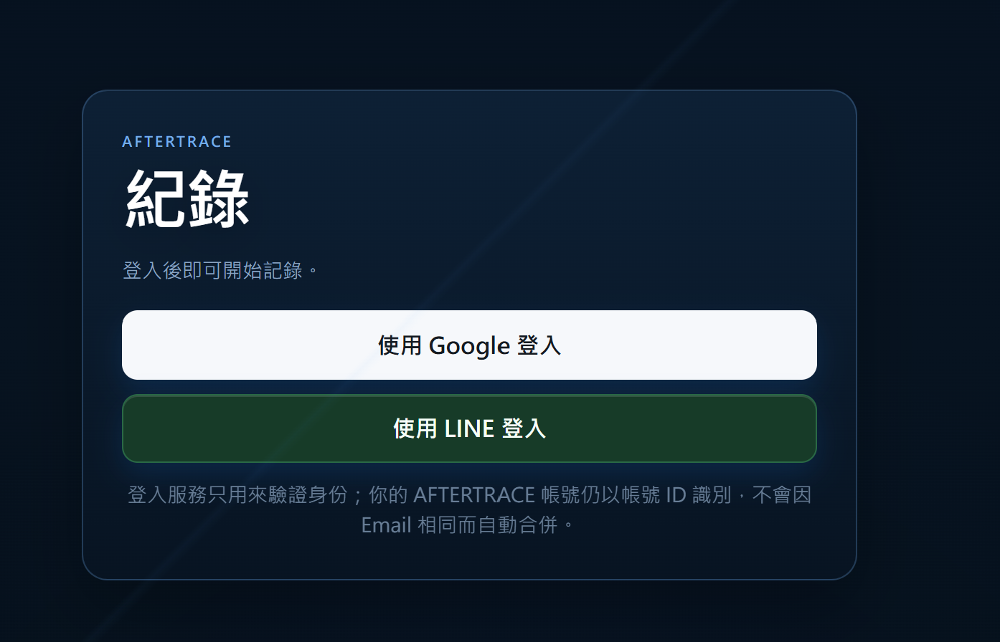
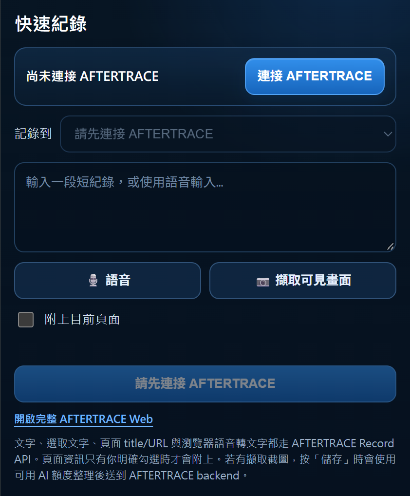

# AFTERTRACE

AFTERTRACE 是一個結合 AI 的工作紀錄與知識整理平台，協助使用者快速保存工作中發生的事情，並在需要時找回相關資訊。

透過網頁、PWA 與 Chrome 擴充功能，使用者可以記錄文字、圖片與短語音。所有 AI 推論都在使用者裝置執行，沒有雲端 AI 備援；首次使用需要下載模型，並要求支援 WebGPU 的瀏覽器。AI 先產生可編輯草稿，使用者確認後才保存文字紀錄。

不支援 PDF、文件或音訊檔上傳；截圖可作為圖片貼上或選擇。圖片與錄音不傳送至後端。詳見 [本機 AI 規範](docs/WORKLOG_LOCAL_AI_POLICY.md)。

## 介面預覽

### 前台登入

透過 Google 或 LINE 登入，開始使用工作紀錄功能。

### 管理後台

提供用戶列表與保存歷史、AI 提示詞及模型設定、公告、回饋、角色、每頁權限與管理帳號。目前無訂閱與金流。

現行介面與驗證見 [後台驗證報告](docs/ADMIN_MANAGEMENT_VALIDATION.md)；舊營運總覽已移除。

### Chrome 擴充功能

保存文字與目前頁面資訊，圖片及短語音則開啟網頁本機解析。下圖為舊版介面參考。

## 主要功能

- **工作紀錄**：新增、編輯與刪除紀錄，以時間軸、關鍵字及日期篩選查找內容。
- **AI 輔助整理**：在本機處理文字、圖片與最多 60 秒的錄音，提供自然語言搜尋、摘要、相關紀錄及待辦建議。
- **個人與群組空間**：區分私人紀錄與群組資料，透過邀請連結及成員權限管理協作。
- **待辦與通知**：管理待辦事項、提醒與通知中心，支援 Web Push 推播。
- **快速擷取**：使用 Chrome 擴充功能保存選取文字、網頁標題與網址；圖片與語音開啟網頁本機解析流程。
- **帳號與管理後台**：整合第三方登入，提供用戶列表、公告、回饋、AI 提示詞／模型設定，以及角色、權限和管理帳號。

## 使用技術

| 類別 | 技術 |
| --- | --- |
| 前端 | React、TypeScript、Vite、PWA |
| 後端 | TypeScript、Hono、Cloudflare Workers |
| 資料庫 | PostgreSQL、Neon、Drizzle ORM |
| AI | Transformers.js、ONNX Runtime Web、WebGPU、Qwen3.5、Whisper（全部裝置本機推論） |
| 登入驗證 | Google／LINE／Apple 登入、OAuth 2.0、PKCE |
| 瀏覽器整合 | Chrome Extension、MediaRecorder、Web Audio、Web Push |
| 訂閱／金流 | 已停用；結帳、取消、付款回呼與訂閱 API 均回傳 410，歷史資料保留 |
| 測試與開發工具 | Vitest、ESLint、pnpm、Wrangler、Git |

## 規格與本機開發

- [現行產品規格](docs/WORKLOG_PRODUCT_SPEC.md)
- [本機 AI](docs/WORKLOG_LOCAL_AI_POLICY.md)／[後台管理](docs/WORKLOG_ADMIN_POLICY.md)
- [本機 Docker 環境](docs/DOCKER_LOCAL_INTEGRATION.md)／[部署規範](docs/WORKLOG_DEPLOYMENT.md)

登入後前台頁首可複製用戶 ID，供客服在後台反查。管理帳號 admin 的首次亂數密碼在初始化回條，不能使用舊版固定測試帳密。
